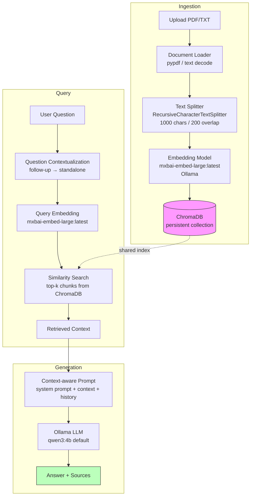

# Document Intelligence AI

A local Retrieval-Augmented Generation (RAG) chatbot that lets users upload PDF and TXT documents, ask questions about their contents, and receive grounded answers — all running locally on Ollama with no external inference APIs.

Built for an AI/ML engineering internship evaluation. The stack is **Python + Ollama + LangChain + ChromaDB + Streamlit**, optimized for a CPU-based laptop (AMD Ryzen 5 5500U, 16 GB RAM, integrated graphics).

## 1. Project Overview

Document Intelligence AI is a document question-answering application. Users upload one or more PDF/TXT files; the app extracts and chunks the text, embeds each chunk with Ollama's `mxbai-embed-large`, stores the vectors in a persistent ChromaDB collection, and answers questions by retrieving the most relevant chunks and passing them (with the question) to a local Ollama LLM (`qwen3:4b` by default).

Every answer is accompanied by source citations (document filename, page number, and a text snippet) so responses can be verified against the uploaded material.

## 2. Problem Statement

Sending private documents to cloud-based LLM APIs raises privacy and data-governance concerns. A fully local RAG pipeline keeps documents, embeddings, and inference on the user's machine, making it suitable for handling sensitive or proprietary material while still offering conversational document Q&A, source attribution, and model switching.

## 3. Features

- **Document upload**: multiple PDF and TXT files via the Streamlit sidebar.
- **Text extraction & splitting**: PyPDFLoader-style extraction via `pypdf`, chunked with `RecursiveCharacterTextSplitter` (1000 char / 200 overlap by default).
- **Embeddings**: Ollama `mxbai-embed-large:latest`, reused across requests.
- **Vector store**: persistent ChromaDB collection with per-chunk metadata (source filename, page number, document id, chunk id).
- **Duplicate prevention**: content-hash (SHA-256) based deduplication — re-uploading the same document is skipped.
- **Semantic retrieval**: top-k similarity search (configurable, default 4) with optional document filtering.
- **RAG question answering**: context-aware prompts grounded in retrieved chunks; answers cite sources.
- **Source citations**: per-answer Sources section with filename, page, and snippet (Streamlit expanders).
- **Conversational memory**: chat history in Streamlit session state with follow-up question contextualization into standalone retrieval queries.
- **Model switching**: dynamically detects installed local Ollama models; default `qwen3:4b`, alternatives `gemma:2b` / `qwen2.5-coder:7b`; cloud models excluded.
- **Model comparison**: optional side-by-side comparison of two models on the same question + retrieved context, with generation latency for each.
- **Clear chat / clear database** actions with confirmation.
- **Error handling**: user-friendly messages for Ollama unavailability, missing models, corrupted/empty PDFs, unsupported formats, and empty retrieval results.
- **Logging**: Python logging for backend operations.

## 4. Technology Stack

| Component | Technology | Purpose |
|---|---|---|
| Language | Python 3.10+ | Application logic |
| LLM runtime | Ollama | Local LLM inference (`qwen3:4b`, `gemma:2b`, `qwen2.5-coder:7b`) |
| Embeddings | `mxbai-embed-large:latest` | Chunk and query embedding via Ollama |
| RAG framework | LangChain (`langchain`, `langchain-community`, `langchain-ollama`, `langchain-chroma`, `langchain-text-splitters`) | Chunking, prompts, chains, integrations |
| Vector DB | ChromaDB | Persistent vector storage and similarity search |
| PDF processing | `pypdf` | Text extraction from PDFs |
| Frontend | Streamlit | Web UI |
| Config | `python-dotenv` | Environment-based configuration |
| Testing | `pytest` | Unit tests |

## 5. Architecture



## 6. RAG Workflow

### Ingestion (document upload)
1. User uploads PDF/TXT file(s) in the sidebar.
2. Each file's content hash (SHA-256) is computed; files whose hash is already indexed are skipped (duplicate prevention).
3. Text is extracted (`pypdf` for PDFs, UTF-8/latin-1 decode for TXT). Empty or unreadable documents produce a visible error instead of being silently ignored.
4. Text is split into overlapping chunks (`RecursiveCharacterTextSplitter`, 1000/200).
5. Each chunk receives metadata: `source`, `page`, `document_id`, `chunk_id`.
6. Chunks are embedded with `mxbai-embed-large:latest` and stored in ChromaDB under `./data/chroma_db`, persisting across restarts.

### Query (question answering)
1. User asks a question. Follow-up questions are contextualized into standalone queries using recent conversation history.
2. The (contextualized) question is embedded with the same embedding model.
3. ChromaDB returns the top-k most similar chunks.
4. A system prompt instructs the LLM to ground answers in the retrieved context, avoid hallucination, and say when information is unavailable.
5. The selected Ollama LLM generates the answer.
6. The answer is shown with a Sources section (filename, page, snippet) and generation latency.

Switching the generation model does **not** re-index documents; changing the embedding model triggers re-indexing because embedding dimensions/vector spaces differ.

## 7. Project Structure

```
local-rag-chatbot/
├── app.py                      # Streamlit frontend
├── requirements.txt            # Pinned dependencies
├── README.md                   # This file
├── .env.example                # Example environment configuration
├── .gitignore                  # Git ignore rules
│
├── backend/
│   ├── __init__.py
│   ├── ollama_manager.py       # Ollama connectivity, model discovery, validation
│   ├── document_processor.py   # PDF/TXT loading, splitting, metadata, hashing
│   ├── embeddings.py           # OllamaEmbeddings wrapper
│   ├── vector_store.py         # ChromaDB wrapper: insert, search, dedupe, clear
│   ├── rag_pipeline.py         # Retrieval, prompts, LLM generation, sources, compare
│   └── chat_manager.py         # Conversation history & follow-up contextualization
│
├── config/
│   ├── __init__.py
│   └── settings.py             # Centralized configuration
│
├── data/                       # ChromaDB persistent storage (created at runtime)
│   └── chroma_db/
│
└── tests/
    ├── __init__.py
    ├── test_document_processor.py
    ├── test_vector_store.py
    ├── test_rag_pipeline.py
    ├── test_chat_manager.py
    └── test_ollama_manager.py
```

### Module responsibilities

- **`document_processor.py`** — Loads PDF and TXT files from bytes, extracts text (page-aware for PDFs), splits text with `RecursiveCharacterTextSplitter`, attaches metadata (`source`, `page`, `document_id`, `chunk_id`), computes SHA-256 content hashes for duplicate detection, and reports per-file status/errors.
- **`embeddings.py`** — Initializes and caches a reusable `OllamaEmbeddings` instance (`mxbai-embed-large:latest`), validates the embedding model exists in Ollama, and exposes it to the vector store and RAG pipeline.
- **`vector_store.py`** — Wraps ChromaDB with a persistent collection. Inserts chunks with embeddings/metadata, prevents duplicate document ingestion by `document_id`, performs top-k similarity search with optional document filtering, reports indexed document IDs, and clears the collection.
- **`rag_pipeline.py`** — Orchestrates retrieval → prompt construction → LLM generation. Builds a context-aware prompt with strict grounding rules, extracts source citations from retrieved chunks, supports question contextualization for follow-ups, and offers a sequential two-model comparison with latency measurement.
- **`ollama_manager.py`** — Checks Ollama availability (`/api/tags`), discovers installed models, separates chat models from embedding models, excludes cloud models (`...-cloud` tags), and validates that a requested model is installed locally (never auto-downloads).

### Complete flow: PDF upload → answer

1. User selects a PDF in the sidebar and uploads it.
2. `document_processor.process_document` hashes the file, extracts text with `pypdf` (recording page numbers), and splits into chunks with metadata.
3. If the content hash is new, `vector_store.add_documents` embeds the chunks via `OllamaEmbeddings` (`mxbai-embed-large`) and persists them to ChromaDB.
4. User asks a question. `chat_manager` contextualizes follow-ups; the query is embedded with the same model.
5. `rag_pipeline` retrieves top-k chunks from ChromaDB, builds a grounded prompt (system prompt + context + recent history), and calls the selected Ollama LLM (`qwen3:4b` default).
6. The answer renders in the chat with a Sources section (filename, page, snippet) and generation time.

## 8. Installation

### Prerequisites

- Python 3.10+ (developed/tested on Python 3.10.11; code targets Python 3.11+ per the assignment but remains compatible with 3.10).
- [Ollama](https://ollama.com) installed and running (`http://localhost:11434`).
- The following Ollama models already pulled (do not download additional models):
  - `qwen3:4b` (default generation model)
  - `mxbai-embed-large:latest` (embedding model)
  - Optional: `gemma:2b`, `qwen2.5-coder:7b` (alternative generation models)

### Setup

```powershell
# 1. Clone / enter the project folder
cd D:\Task1_Intern

# 2. Create and activate a virtual environment (recommended)
python -m venv .venv
.venv\Scripts\Activate.ps1

# 3. Install dependencies
pip install -r requirements.txt

# 4. Configure environment
copy .env.example .env
# (edit .env only if you need to change paths or model names)
```

## 9. Ollama Setup

Verify Ollama is running and your models are available:

```powershell
# Check the Ollama server
curl http://localhost:11434/api/tags

# Or with the ollama CLI
ollama list
```

Expected output (your installed models):

```
NAME                         ID              SIZE      MODIFIED
qwen3:4b                     ...             2.5 GB    ...
gemma:2b                     ...             1.7 GB    ...
qwen2.5-coder:7b             ...             4.7 GB    ...
mxbai-embed-large:latest     ...             669 MB    ...
gemma4:31b-cloud               ...             -         ...
deepseek-v4.1-flash:cloud    ...             -         ...
```

- The app auto-detects installed models on startup.
- `qwen3:4b` is the default generation model.
- Cloud models (`gemma4:31b-cloud`, `deepseek-v4.1-flash:cloud`) are excluded from local model selection and comparison.
- The app will **never** automatically download models. If a selected model is missing, a friendly message tells you to run `ollama pull <model>`.

Do not pull unnecessary models; the assignment uses only the models you already have.

## 10. Running the Application

```powershell
# Make sure Ollama is running in the background
streamlit run app.py
```

Then open the URL Streamlit prints (typically `http://localhost:8501`).

### Sidebar controls
- Upload PDF/TXT documents and view the indexed document list with chunk counts.
- Select the generation LLM (default `qwen3:4b`).
- View the embedding model (`mxbai-embed-large:latest`).
- Configure retrieval top-k (1–10).
- Toggle "Compare models" and pick a second model for side-by-side comparison.
- Clear chat or clear the document database (with confirmation).

### Main area
- Welcome screen with example questions until documents are indexed.
- Conversational chat with user/AI messages.
- Each AI answer shows model, generation time, and an expandable Sources section.

## 11. Example Questions

After uploading a document (e.g., a PDF about a product or research topic):

- "What is the main topic of the document?"
- "Summarize the key findings in the uploaded PDF."
- "List the advantages mentioned in the document."
- "Explain that further." (follow-up — uses conversational memory)
- "Compare the concepts discussed earlier." (follow-up)
- "What are its advantages?" (follow-up with pronoun resolution)

## 12. Troubleshooting

| Problem | Likely cause | Solution |
|---|---|---|
| "Ollama is unavailable" | Ollama not running | Start Ollama (`ollama serve`), then refresh the page |
| "Model '...' is not installed locally" | Selected model missing | Run `ollama pull <model>` (only models you need) |
| No documents indexed / empty answers | No files uploaded or extraction failed | Upload PDF/TXT; check the sidebar status for errors |
| "No relevant document context found" | Question unrelated to docs or top-k too low | Rephrase the question or increase top-k in the sidebar |
| Generation is very slow | CPU inference on a 7B/4B model | Expected on CPU; use `gemma:2b` for faster responses |
| Chroma file lock on Windows | Previous run didn't release `chroma.sqlite3` | Close the app, delete `data/chroma_db`, restart |

## 13. Future Improvements

- Add a document deletion action (remove individual documents from the index).
- Add persistent chat sessions (save history to disk).
- Support more file types (DOCX, MD, HTML).
- Add a re-index button for when the embedding model changes.
- Add citation highlighting inside answers.
- Add optional hybrid (keyword + semantic) retrieval.

## Testing

Run the offline test suite (no Ollama server required):

```powershell
python -m pytest tests/ -v
```

28 tests pass, covering document loading (TXT and mocked PDF), text splitting, chunk metadata, empty/corrupted document handling, duplicate detection, vector store insert/search/dedup/clear, RAG prompt construction, source attribution, conversation memory, contextualization, and Ollama model discovery/validation.

Tests use mocked/fake models and embeddings so they run without a running Ollama server.

## Notes

- Python 3.10 is used in this environment; dependency pins were chosen to remain compatible with 3.10 (e.g. `chromadb==0.5.13`, `pypdf==5.1.0`). The assignment targets Python 3.11+.
- ChromaDB telemetry errors in logs are harmless and disabled where possible (`anonymized_telemetry=False`).
- No benchmarks, performance metrics, or accuracy percentages are claimed; generation speed depends on CPU and model size.
